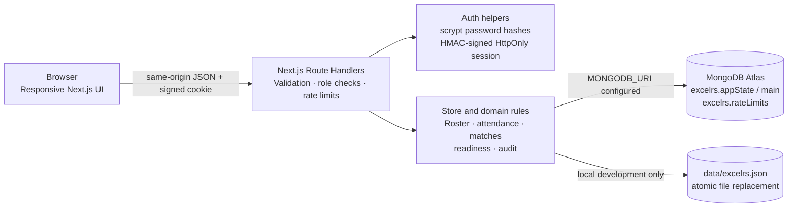

<div align="center">
  
  <h1>KhelGrid · Academy Desk</h1>
  <p><strong>The grassroots sports desk, built for the next play.</strong></p>
  <p>Responsive academy operations for player records, training attendance, match results, and trial readiness.</p>
</div>

---

## What KhelGrid is

KhelGrid is a mobile-compatible web app for a sports academy. It replaces a coach’s paper notebook with a shared player register, attendance sheets, match records, and a scouting view.

The service supports multiple independent academies in the same deployment. Any Coach can create a new academy and becomes its owner; a Coach can alternatively request to join an existing academy with its code. Players and Scouts also join using the code and wait for the relevant Coach’s approval. Each academy has its own players, sports, sessions, fixtures, access requests, and audit history. Coaches enter real people and venues; KhelGrid does not seed demo players, match opponents, grounds, or credentials.

## What is implemented

- **Sign in and account requests:** A Coach can create a new academy at any time, even when other academies already exist, or request access to an existing academy using its code. The new academy’s creator becomes its owner. The owner approves Coach access; approved Coaches manage only their assigned sports. Players sign up with the code and select sports. A Player who links a Coach-created Player ID needs Coach approval before signing in; a self-created Player profile can sign in immediately but stays off the roster until a Coach approves its sport request. Scouts request academy access with the code and wait for Coach approval.
- **Multiple sports in one academy:** Owners choose offered sports from a fixed catalogue. A player may join more than one offered sport. Coaches can be assigned sports; the owner can manage all sports.
- **Player register:** Coaches add a player with name, age, and one or more sports. KhelGrid assigns a Player ID. Archiving a player removes them from active rosters while preserving past attendance and match history; restoring makes them active again when at least one of their sports is still offered.
- **Training sessions and attendance:** A Coach opens one session for a date and sport. The active roster is snapshotted when it opens. The Coach marks every player Present or Absent, then closes the session. A closed session is locked. The app records the actor and time for attendance changes, but the Coach is the source of the attendance attestation.
- **Fixtures and match reports:** Coaches schedule fixtures with a date, sport, opponent, and optional venue. To record a result, a closed session for the same date and sport must exist. Only players marked Present may be scored. Match reports show the entered final score, official outcome, optional margin or finish detail, player statistics, and Coach-entered ratings. Football fixtures also support saving a starting XI of up to eleven players.
- **Readiness and scouting:** Readiness is calculated per sport: attendance must be at least 75% of that player’s closed sessions, and the player must have scores recorded in at least two played matches in that sport. Scouts see active Ready players only. Players see only their own profile and history.
- **Access and academy management:** Coaches have a separate Access page for pending account and sport requests. The owner manages offered sports and may transfer ownership to another active Coach. Members can leave; access is disabled while historical records remain. The academy cannot be left without an active Coach.
- **Record and system support:** Coach-only audit history retains the latest 5,000 events, with the endpoint returning the latest 200 relevant events. `/api/health` checks MongoDB availability without returning credentials or connection details.

## User flows and access rules

| Role | Can do | Access boundary |
| --- | --- | --- |
| Owner Coach | Configure their academy’s sports; approve Coach access; manage all sports; transfer ownership | Each academy has one owner at a time; transfer is required before that owner leaves |
| Coach | Manage assigned sports; add/archive/restore players; open and close sessions; mark attendance; schedule and record matches; review access requests | A Coach can manage only assigned sports; Coach account approval belongs to the owner |
| Player | View their own profile, approved sports, attendance, and match history; request another offered sport; leave the academy | Cannot read another player’s record or self-approve sport access |
| Scout | View the academy’s Ready players | No access to attendance sheets, all-player roster, or match administration |

## Product rules and data integrity

- A session is unique by date and sport. It captures its player roster at opening; adding a player later does not rewrite an existing sheet.
- Every player on the session sheet must receive a Present or Absent mark before it can be closed. Closing is final in the current UI and API.
- Match scores require a closed session on the same date and sport. The server rejects duplicate player rows, unregistered players, and players marked Absent.
- Readiness is derived from closed session and played match records, not a manually editable status. A match counts for readiness only when the player has a score row.
- Match deletion removes the fixture/result and its player score rows from current views. The separate attendance record remains; an audit event notes the deletion.
- Archiving or leaving does not delete historical sessions or match reports.
- Academy and player sport choices are checked against a canonical catalogue of sport names; free-text spellings are not accepted as sport identities.
- Attendance, scores, and ratings are Coach-entered. The software records who made a change, but it cannot independently verify physical attendance or certify the fairness of ratings.

## Architecture



The app uses the Next.js App Router: `app/page.tsx` contains the client workspace and role-based sections; `app/api/**/route.ts` contains server endpoints; `lib/` contains authentication, validation, sport catalogue, rate limiting, types, and persistence. Every account and record carries an `academyId`; handlers resolve the signed-in user’s academy and filter reads and writes to that tenant. Academy codes are unique join credentials, not a way to read its player data. MongoDB stores all academies and related records in one revision-checked `appState` document (`_id: "main"`). Production rate-limit buckets use a separate `rateLimits` collection with TTL expiry. Without `MONGODB_URI`, local development uses `data/excelrs.json` instead.

### Core data model

The app state document contains arrays of `Academy`, `User`, `Player`, `Session`, `Match`, and `AuditEvent` records. Each member record is assigned an `academyId`. Sport join requests live with their player record; attendance rows live with their session; player score and rating rows live with their match. Passwords are stored as salted scrypt hashes (`passwordHash` and `passwordSalt`), never as the submitted plaintext. Public API user objects omit both password fields. Existing single-academy state is normalized on read: the previous academy and its users and records retain their IDs and are assigned that academy’s ID; the normalized shape is saved on the next successful write.

## Design decisions

- **Multi-academy isolation:** A deployment can host multiple academies. Signup creates a distinct academy record and owner, while academy codes route join requests to the intended academy. Server-side `academyId` scoping is applied to operational endpoints. This is logical tenant isolation in a shared app state document, not a database-per-academy boundary.
- **One academy can offer multiple sports:** Sports use stable catalogue names and IDs at the application boundary, preventing spelling variants from splitting a roster. Player progress and Coach permissions are scoped per sport.
- **Coach-attested attendance:** The Coach marks the attendance sheet and closes it. This gives a clear accountable workflow without claiming that a browser can prove physical presence.
- **Generic result entry, sport-aware labels:** Player stat labels follow common sports (for example, goals, runs, points, time, or weight), while final scores and outcome details remain editable. This records a useful match report without pretending to encode the full rules of every sport.
- **Server-enforced permissions:** Role checks, sport scopes, attendance rules, and readiness inputs are checked by API handlers; the UI is not the security boundary.
- **Responsive brutalist visual system:** Off-white paper, dark ink borders, hard offset shadows, and a high-visibility lime accent make actions and status blocks legible on desktop and phone-sized screens. The intro video is a local public asset, not an external embed.
- **Small deployment footprint:** Next.js route handlers and MongoDB keep the app self-contained; no separate API server, paid service, or third-party authentication provider is required.

### Technology

- Next.js App Router and React for the responsive web interface and server endpoints.
- MongoDB Node.js driver for Atlas storage; Node.js filesystem persistence for a single local development instance.
- Node.js `crypto` (`scrypt`, HMAC, and secure random values) for password hashing, session signatures, and generated identifiers.
- `lucide-react` for interface icons and `qrcode.react` for academy QR codes.
- TypeScript and custom CSS for application types and the visual system.

## Run locally

Requirements: Node.js (LTS recommended) and npm.

```sh
npm install
cp .env.example .env.local
npm run dev
```

Open [http://localhost:3000](http://localhost:3000). A Coach can create a new academy, or choose to request access to an existing one. The Coach who creates an academy becomes its owner. When `MONGODB_URI` is blank, local records are written to `data/excelrs.json`; that file is local development data and is ignored by Git. To use Atlas locally, fill in `.env.local` with the URI for a dedicated database user and the database name. Never paste credentials into source code or commit `.env.local`.

### Environment variables

| Variable | Required | Purpose |
| --- | --- | --- |
| `MONGODB_URI` | Production: yes; local: optional | MongoDB Atlas connection string. URL-encode reserved characters in credentials. |
| `MONGODB_DB` | No | Database name; defaults to `excelrs`. |
| `SESSION_SECRET` | Production: yes | Unique random secret of at least 32 characters used to sign sessions and protect rate-limit identifiers. |

Generate a secret with `openssl rand -base64 48`. Keep Atlas credentials and `SESSION_SECRET` in `.env.local` or the host’s encrypted environment settings. `.env.example` contains placeholders only.

## Build and host

```sh
npm run build
npm run start
```

For Vercel, add `MONGODB_URI`, `MONGODB_DB`, and a unique `SESSION_SECRET` to the project’s server-side environment variables. Use a dedicated Atlas database user scoped to the app database, set an appropriate Atlas Network Access policy for the deployment, and confirm `/api/health` reports healthy before inviting users. Do not use an Atlas Admin database user for the app. Back up the database and test restoring a backup before relying on it for academy records.

## Security and privacy notes

- Session cookies are signed, `HttpOnly`, `SameSite=Lax`, and `Secure` in production; logout and leaving invalidate access. Passwords use Node’s scrypt password KDF with a per-password random salt.
- Mutating JSON endpoints enforce same-origin requests and a 32 KB body limit. Login, signup, and academy lookups are rate-limited; production counters are stored in MongoDB. Security headers and `no-store` responses are configured.
- The app collects names and ages, including ages under 18. Before real academy use, establish and document guardian consent, retention, deletion, access, and incident-handling procedures with the responsible organization and confirm applicable Indian privacy obligations. The app does not currently provide a full data-export or account-recovery flow.
- The help panel currently displays `academy@example.com` as a clearly labeled placeholder. Replace it with an address that is monitored before launch.
- A MongoDB credential was pasted into the development conversation during setup. Rotate that database user’s password in Atlas before using or publishing the deployment, even though the project code does not store that connection password.

## Current limitations and production follow-up

The app supports multiple academies, but its persistence layer is still designed for a small deployment. All tenants share one `appState` document, which has MongoDB’s 16 MB document limit and serializes writes through a revision check. A larger service should move to academy-scoped collections with indexes and transactions, plus tested migration and recovery tooling. Usernames are globally unique because login currently asks only for username and password; account discovery and password recovery are not yet provided.

There is no password reset, MFA, email delivery, push notification, inter-academy fixture request, live attendance verification, external sports-data integration, or complete sport-specific scoring engine. Match scores, outcomes, and ratings are coach-entered. The built-in rate limiter is useful for this small app but needs load testing and operational monitoring before broad public use. The project currently has no automated test suite, lint script, or CI workflow; those should be added before a production launch.

## Project structure

```text
app/
  api/                 Next.js Route Handlers for auth, academy, access,
                       players, attendance, matches, audit, and health
  globals.css          Responsive visual system and component styles
  layout.tsx           App metadata and root document
  page.tsx             Sign-in, onboarding, and role-based workspace
lib/
  auth.ts              Password verification, signed sessions, role checks
  http.ts              Same-origin and bounded JSON request helpers
  rate-limit.ts        Local and MongoDB-backed request limits
  sports.ts            Canonical sports catalogue and date validation
  store.ts             Data model normalization and persistence
public/
  khelgrid-intro.mp4   Local intro animation used on the sign-in screen
  khelgrid-mark.svg    Transparent KhelGrid ball-in-motion mark
```

## License and ownership

**All rights reserved. Copying, modifying, redistributing, publishing, or using this project or any part of its source code is not permitted without prior written permission from the project owner.** Making the repository public does not grant permission to reuse the code. No open-source license is granted.
