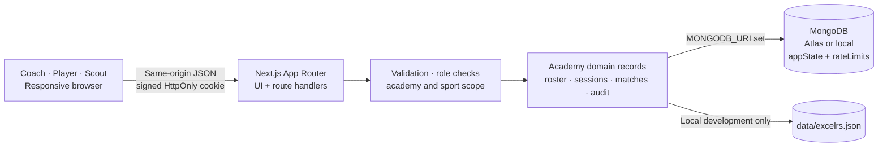

<div align="center">
  
  <br />
  <h1>KHELGRID · SPORTS DESK</h1>
  <p><strong>Every session. Every score. Every next play.</strong></p>
  <p>A field-ready, mobile-friendly workspace for grassroots sports academies.</p>
  <p>
    
    
    
    
  </p>
  <p><a href="#get-on-the-field">Get started</a> · <a href="#how-the-desk-works">Explore the workflow</a> · <a href="#architecture">Architecture</a></p>
</div>

---

## The game plan

KhelGrid gives a coach one practical place to manage a real academy: build a player register, take attendance, schedule fixtures, record results and ratings, and see who is ready for a trial. The interface works across desktop and mobile browsers.

Each deployment serves one configured academy. The app reuses an existing single academy identity. A fresh database requires an operator to configure its identity; KhelGrid does not invent or create one during Coach signup. If records reference multiple academy identities, the app fails closed and requires a reviewed migration rather than merging records automatically.

New Coach, Player, and Scout accounts register with a verified email and require the applicable approval. Player registration collects personal details and requested sports, but no academy code or Player ID. A Coach links the verified pending account to the matching existing player record before approval. Existing accounts without email keep username/password login. The app itself does not seed demo accounts or passwords. An optional guarded local-only data seeder is documented below.

## How the desk works

| 01 · BUILD THE ROSTER | 02 · RUN TRAINING | 03 · PLAY THE FIXTURE | 04 · FIND THE NEXT PLAY |
|:--|:--|:--|:--|
| Add real players, assign a stable Player ID, and choose one or more academy sports. | Open a dated session for one sport. Mark every rostered player Present or Absent, then close the sheet. | Schedule an opponent and venue. Record player scores against a closed same-day session; only present players can be scored, and the final team result is optional. | Readiness is calculated per sport. Scouts see eligible players with aggregate scores and average Coach ratings, and can call them for a trial. Each player sees only their own history and trial calls. |

### A clear path for every role

<details>
<summary><strong>Coach · own the desk</strong></summary>

Register for the configured academy with a verified email. The first verified Coach becomes its owner; subsequent Coaches require owner approval. Coaches manage assigned sports, players, attendance, matches, and access requests. Match structures and scoring are configured across all 28 catalogue sports.
</details>

<details>
<summary><strong>Player · follow your progress and trial calls</strong></summary>

Register with your name, email, age, and requested sports. After email verification, a Coach matches your pending request to your existing player record and approves it. Players can review only their own attendance, match history, and aggregate ratings. The **Trials** tab shows active scout calls (shortlisted) and withdrawn calls. Leaving disables access while historical records remain with the academy.
</details>

<details>
<summary><strong>Scout · see trial-ready players and call trials</strong></summary>

Register for the configured academy with a verified email. Once a Coach approves the Scout account, the Scout can see active players who meet the readiness rule, including aggregate score and average Coach rating per ready sport, without access to attendance sheets or match administration. A scout can call a Ready player for a trial in a ready sport and withdraw that call later. Coaches can see active and withdrawn calls in the Scouting view.
</details>

## The rules behind readiness

KhelGrid derives trial readiness separately for each sport:

```text
Ready = Present marks / closed sessions for that sport where the player was rostered >= 75%
        AND the player has score rows in at least 2 played matches
```

A trial call is an in-app shortlist decision by a scout. It does not change attendance, matches, or readiness, and the player can see active and withdrawn calls in **Trials**. Coaches attest attendance and enter results and ratings; the app does not verify physical presence. Closing a session locks its sheet after every rostered player has a Present or Absent mark. Match scheduling records date, optional local time and venue, opponent, sport, and format. Team sheets support starters, substitutes, optional captain, jersey number, and configured positions. To record performance, each participant must belong to that sport and have been marked Present in a closed session on that date. Each score row records one configured non-negative scalar metric with the format's precision; a numeric Coach rating from 1 to 10 in half-point steps is optional. The final team score and outcome are optional; when supplied, both final scores and an outcome are required. Sport-specific official result rules are not calculated by the app. A Coach can delete a match record; the audit history and separate attendance sheet remain.

### Performance analytics

Coaches can open **Analytics** and select an assigned academy sport and format to review its active roster, closed-session attendance, scheduled and played fixture counts, recorded outcomes, player score aggregates, and optional Coach ratings. Attendance is shown as Present marks divided by rostered player opportunities in closed sessions. Match outcomes are counted only when explicitly recorded; the app does not infer wins or losses from a sport score string. Rating averages show their sample count, and recent trends omit fixtures without relevant values. A format's configured aggregation may be a sum, average, or best result; values from different sports and formats should not be compared. Legacy fixtures with missing or unsupported formats are shown as unclassified and excluded from format analytics. The current score model stores one scalar per player per match, so multi-stat records such as complete cricket batting/bowling lines are not supported. Analytics use the academy- and sport-scoped records already returned to the signed-in Coach; they do not add access to player, scout, or other academy data.

## Architecture



Each account and operational record carries an `academyId`. Server handlers select the signed-in user’s academy before reading or changing its data. Passwords are stored as salted scrypt hashes; session cookies are signed, `HttpOnly`, `SameSite=Lax`, and `Secure` in production. The small-deployment store keeps academy records in one revision-checked MongoDB `appState` document. Local development without a MongoDB URI uses an atomic JSON file.

## Get on the field

### Requirements

- Node.js 20 LTS or newer and npm
- A MongoDB database (Atlas for shared or deployed use, or a local MongoDB) — optional for local-only development
- The project source (a GitHub account is not required to run a downloaded copy)
- A Vercel account only if you want to deploy there

### Run locally without Atlas

```bash
git clone <your-repository-url>
cd <repository-folder>
npm ci
cp .env.example .env.local
npm run dev
```

Open [http://localhost:3000](http://localhost:3000). Before the first signup, configure `ACADEMY_ID`, `ACADEMY_NAME`, and `ACADEMY_LOCATION` in the local environment with the real academy identity you intend to use. With `MONGODB_URI` blank, local records go to `data/excelrs.json`; this local file is ignored by Git and is not shared between machines. Email verification requires SMTP configuration and a matching APP_URL. To clone a public repository, use its Git URL in place of `<your-repository-url>`; otherwise download the source and open a terminal in its project folder before running `npm ci`.

### Seed a local demo (optional, local-only)

The demo seeder never reads `.env.local` or `MONGODB_URI`. It requires `KHELGRID_DEMO_MONGODB_URI` to identify a loopback MongoDB database named `khelgrid_demo_local`, refuses when `NODE_ENV=production`, and refuses to overwrite any non-empty database without its seed marker. It creates no user accounts or shared passwords. Set the application’s `MONGODB_URI` and `MONGODB_DB` to the same local database before opening the app.

In one terminal, start a local MongoDB (if installed):

```bash
mkdir -p data/mongo
mongod --dbpath data/mongo --port 27018 --bind_ip 127.0.0.1
```

In another terminal, start the app against that local database. The inline variables override `.env.local`:

```bash
MONGODB_URI=mongodb://127.0.0.1:27018/khelgrid_demo_local \
MONGODB_DB=khelgrid_demo_local \
SESSION_SECRET="$(openssl rand -base64 48)" \
npm run dev -- -p 3200
```

Set `KHELGRID_DEMO_MONGODB_URI` to that same local URI and set `ACADEMY_ID`, `ACADEMY_NAME`, and `ACADEMY_LOCATION` to a fictional demo identity chosen for local use. Then seed manually:

```bash
node scripts/seed-demo.mjs
```

Open [http://localhost:3200](http://localhost:3200), register a Coach, and complete email verification to inspect the seeded fictional players, attendance, historical and upcoming fixtures, and scores across five sports. No login credentials are generated by the seeder. Configure the local SMTP variables or use an existing verified legacy account to access protected screens.

Running the seed again is an idempotent no-op. The seeder does not reset a database or print secrets. Use this isolated demo instead of an Atlas development database.

### Connect MongoDB Atlas

1. Create a database user with access only to the application database. Do not use an Atlas Admin account for the app.
2. Add the development machine or deployment network to the Atlas Network Access list.
3. Put the application connection string in `.env.local` as `MONGODB_URI`. URL-encode reserved characters in the password.
4. Set `MONGODB_DB=excelrs` or another database name. Keep `.env.local` private; Git ignores it.
5. Restart the app and check `/api/health` for database status.

Example `.env.local` values:

```dotenv
MONGODB_URI=mongodb+srv://<app-user>:<encoded-password>@<cluster-host>/<database>
MONGODB_DB=excelrs
SESSION_SECRET=<at-least-32-random-characters>
```

Generate a session secret with `openssl rand -base64 48`. The sample secret in `.env.example` is a placeholder and must never be used in production.

### Deploy to Vercel

For Vercel, configure server-side `MONGODB_URI`, `MONGODB_DB`, `SESSION_SECRET`, `SMTP_HOST`, `SMTP_PORT`, `SMTP_SECURE`, `SMTP_USER`, `SMTP_PASS`, `EMAIL_FROM`, and canonical HTTPS `APP_URL=https://khelgrid.vercel.app`. Set `ACADEMY_ID`, `ACADEMY_NAME`, and `ACADEMY_LOCATION` only when the production database has no academy record; if one exists, reuse it and ensure any configured ID matches. Never expose secrets as `NEXT_PUBLIC_*`. Use a Gmail App Password and verify sender authorization. Production variables must be configured independently in Vercel; local values do not transfer.

## Built with

| Layer | Choice |
|:--|:--|
| Web app and API | Next.js 15 App Router, React 19, TypeScript |
| Persistence | MongoDB Node.js driver (Atlas or local); local JSON fallback for development |
| Authentication | Node.js crypto: scrypt password hashing and signed session cookies |
| Interface | Custom responsive CSS and Lucide icons |

## Project map

```text
app/
  api/                 Authentication, academy, access, players,
                       sessions, matches, trials, audit, health
  globals.css          Responsive brutalist visual system
  layout.tsx           Document metadata and app shell
  page.tsx             Sign-up, sign-in, role-based workspace
lib/
  auth.ts              Password checks, signed sessions, permissions
  http.ts              Same-origin and bounded JSON helpers
  rate-limit.ts        Request limits
  sports.ts            Canonical sport catalogue and date validation
  readiness.ts         Per-sport readiness, score, and average-rating calculation
  store.ts             MongoDB/local persistence and legacy normalization
  types.ts             Academy and domain record types
public/
  khelgrid-mark.svg    Transparent sports mark
scripts/
  seed-demo.mjs        Optional local-only demo data seed
```

## Before real-world rollout

KhelGrid is configured for one academy. Its small-deployment store keeps all academy records in one revision-checked MongoDB `appState` document, which imposes MongoDB’s 16 MB document limit and serializes write contention. A larger deployment should move to indexed collections with a reviewed migration, backups, monitoring, and load testing. Existing data referencing multiple academy identities is not auto-merged; the application refuses to load it until an operator reviews and migrates the data.

Automated tests (`npm test`) cover email validation and token helpers, mocked SMTP delivery, store behavior, single-academy identity handling, pending role-account construction, player-link eligibility, sport configuration, analytics aggregation, match scoping, team-sheet validation, time validation, and Present-participant rules. The suite also invokes real route-handler functions with mocked framework, session and storage boundaries for all configured sport formats, cross-academy rejection, duplicate player linking and account ownership, plus tests for exact readiness boundaries and demo-seeder protection. These are not full Next.js HTTP/session or MongoDB integration tests. Real database persistence, browser workflows, email receipt, Atlas and deployed isolation still require verification. See [release validation instructions](docs/RELEASE_VALIDATION.md) for the opt-in Mongo runner, process-restart checks, browser checklist and controlled email test. Some tests import TypeScript directly; use Node 24 LTS or another Node release with compatible built-in type stripping for the test runner. Run `npm exec tsc -- --noEmit` and `npm run build` for type and production compilation checks. There is no MFA, automated guardian-consent flow, detailed multi-stat event model, trial scheduling, or external trial notification. Attendance, results, and ratings are coach-entered. The audit log retains up to 5,000 events in the state document. Since player records include minors’ names and ages, establish consent, retention, access, and incident procedures before using real data at scale.

**Credential hygiene:** If a database credential has ever been exposed, rotate it in Atlas before using the database or deploying. Use a dedicated database user, store secrets only in local environment files or the host’s encrypted settings, and never commit them.

## License

All rights reserved. No permission is granted to copy, modify, redistribute, publish, or use this source code without prior written permission from the project owner. Making a repository public does not grant a license.
