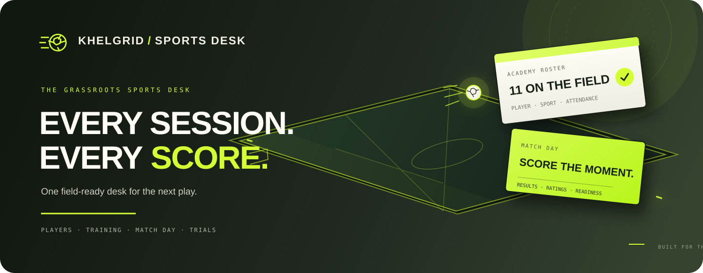
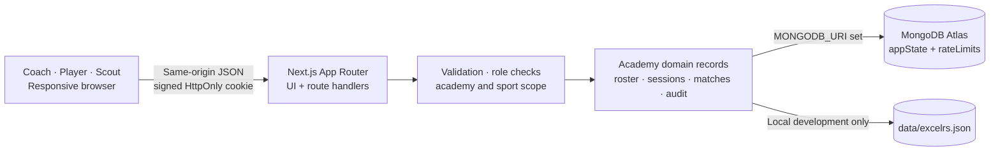

<div align="center">
  
  <br />
  <h1>KHELGRID · SPORTS DESK</h1>
  <p><strong>Every session. Every score. Every next play.</strong></p>
  <p>A field-ready, mobile-friendly workspace for grassroots sports academies.</p>
  <p>
    
    
    
    
  </p>
  <p><a href="#get-on-the-field">Get started</a> · <a href="#how-the-desk-works">Explore the workflow</a> · <a href="#architecture">Architecture</a></p>
</div>

---

## The game plan

KhelGrid gives a coach one practical place to manage a real academy: build a player register, take attendance, schedule fixtures, record results and ratings, and see who is ready for a trial. The interface works across desktop and mobile browsers.

One deployment can host **many independent academies**. A coach can create an academy and become its owner, or request to join another academy using its code. Scouts request academy access by code and wait for Coach approval. Players use an academy code to create or link a profile, then request the offered sports they want to join. A self-created Player login can be active immediately while sport requests remain pending; linking an existing Coach-created Player ID requires approval before that login is active. Records and permissions are scoped to the selected academy.

KhelGrid starts with an empty workspace. It does not seed fictional players, grounds, match results, or login details.

## How the desk works

| 01 · BUILD THE ROSTER | 02 · RUN TRAINING | 03 · PLAY THE FIXTURE | 04 · FIND THE NEXT PLAY |
|:--|:--|:--|:--|
| Add real players, assign a stable Player ID, and choose one or more academy sports. | Open a dated session for one sport. Mark every rostered player Present or Absent, then close the sheet. | Schedule an opponent and venue. Record a result against a closed same-day session; only present players can receive stats and a Coach rating. | Readiness is calculated per sport. Scouts see eligible players; each player sees only their own history. |

### A clear path for every role

<details>
<summary><strong>Coach · own the desk</strong></summary>

Create an independent academy or request to join one. The owner configures offered sports, approves Coach accounts, and can transfer ownership. Coaches manage their assigned sports, players, attendance, matches, and access requests. Football fixtures can also store a starting lineup of up to eleven players.
</details>

<details>
<summary><strong>Player · follow your progress</strong></summary>

Join with an academy code and request one or more sports. A self-created Player login can be used while sport approval is pending, but the Player is not added to an approved sport roster until a Coach approves that request. If the Coach already created the Player record, the Player ID must be linked and approved before sign-in. Players can review only their own attendance and match history. Leaving disables access while historical records remain with the academy.
</details>

<details>
<summary><strong>Scout · see trial-ready players</strong></summary>

Request access to an academy. Once approved, see active players who meet the readiness rule, without access to attendance sheets or match administration.
</details>

## The rules behind readiness

KhelGrid derives trial readiness separately for each sport:

```text
Ready = Present marks / closed sessions that included the player >= 75%
        AND the player has score rows in at least 2 played matches
```

Coaches attest attendance and enter results and ratings; the app does not verify physical presence. Closing a session locks its sheet after every rostered player has a Present or Absent mark. To record a match, at least one player must belong to that sport and have been marked Present in a closed session on that date. Each score row requires a non-negative whole-number stat and a Coach rating from 1 to 10 in half-point steps. Final score and outcome are Coach-entered; sport-specific result rules are not calculated by the app. A Coach can delete a match record; the audit history and separate attendance sheet remain.

## Architecture



Each account and operational record carries an `academyId`. Server handlers select the signed-in user’s academy before reading or changing its data. Passwords are stored as salted scrypt hashes; session cookies are signed, `HttpOnly`, `SameSite=Lax`, and `Secure` in production. The small-deployment store keeps academy records in one revision-checked MongoDB `appState` document. Local development without a MongoDB URI uses an atomic JSON file.

## Get on the field

### Requirements

- Node.js 20 LTS or newer and npm
- A MongoDB Atlas database for shared or deployed use (optional for local-only development)
- The project source (a GitHub account is not required to run a downloaded copy)
- A Vercel account only if you want to deploy there

### Run locally without Atlas

```bash
git clone <your-repository-url>
cd <repository-folder>
npm ci
cp .env.example .env.local
npm run dev
```

Open [http://localhost:3000](http://localhost:3000), choose **Create account → Coach → Create a new academy**, and set up your real academy. With `MONGODB_URI` blank, local records go to `data/excelrs.json`; this local file is ignored by Git and is not shared between machines. To clone a public repository, use its Git URL in place of `<your-repository-url>`; otherwise download the source and open a terminal in its project folder before running `npm ci`.

### Connect MongoDB Atlas

1. Create a database user with access only to the application database. Do not use an Atlas Admin account for the app.
2. Add the development machine or deployment network to the Atlas Network Access list.
3. Put the application connection string in `.env.local` as `MONGODB_URI`. URL-encode reserved characters in the password.
4. Set `MONGODB_DB=excelrs` or another database name. Keep `.env.local` private; Git ignores it.
5. Restart the app and check `/api/health` for database status.

Example `.env.local` values:

```dotenv
MONGODB_URI=mongodb+srv://<app-user>:<encoded-password>@<cluster-host>/<database>
MONGODB_DB=excelrs
SESSION_SECRET=<at-least-32-random-characters>
```

Generate a session secret with `openssl rand -base64 48`. The sample secret in `.env.example` is a placeholder and must never be used in production.

### Deploy to Vercel

Import the repository, then add `MONGODB_URI`, `MONGODB_DB`, and a unique `SESSION_SECRET` to the Vercel project’s **server-side** environment variables. Configure Atlas network access for the deployment, deploy, and verify `/api/health` before inviting users. Never expose these values as `NEXT_PUBLIC_*` variables. Login usernames are unique across the entire deployment because login currently accepts a username and password, not an academy selector.

## Built with

| Layer | Choice |
|:--|:--|
| Web app and API | Next.js 15 App Router, React 19, TypeScript |
| Persistence | MongoDB Node.js driver; local JSON fallback for development |
| Authentication | Node.js crypto: scrypt password hashing and signed session cookies |
| Interface | Custom responsive CSS, Lucide icons, generated academy QR codes |

## Project map

```text
app/
  api/                 Authentication, academy, access, players,
                       sessions, matches, audit, health
  globals.css          Responsive brutalist visual system
  layout.tsx           Document metadata and app shell
  page.tsx             Sign-up, sign-in, role-based workspace
lib/
  auth.ts              Password checks, signed sessions, permissions
  http.ts              Same-origin and bounded JSON helpers
  rate-limit.ts        Request limits
  sports.ts            Canonical sport catalogue and date validation
  store.ts             MongoDB/local persistence and legacy normalization
  types.ts             Academy and domain record types
public/
  khelgrid-mark.svg    Transparent sports mark
```

## Before real-world rollout

KhelGrid has multi-academy workflows, but this is an early small-deployment build. Academies currently share one MongoDB document, which imposes a 16 MB document limit and serializes writes. A larger service should use academy-scoped collections and indexes, transaction and migration tooling, backups, monitoring, and load-tested rate limiting.

There is no password reset, MFA, email delivery, automated test suite, CI workflow, full data export, guardian-consent flow, or complete sport-specific scoring engine. Attendance, results, and ratings are coach-entered. The audit log retains up to 5,000 events in the state document, and the Coach endpoint returns up to the latest 200 events within the Coach’s academy and sport permissions. Since player records include minors’ names and ages, establish consent, retention, access, and incident procedures before using real data at scale.

**Credential hygiene:** If a database credential has ever been exposed, rotate it in Atlas before using the database or deploying. Use a dedicated database user, store secrets only in local environment files or the host’s encrypted settings, and never commit them.

## License

All rights reserved. No permission is granted to copy, modify, redistribute, publish, or use this source code without prior written permission from the project owner. Making a repository public does not grant a license.
